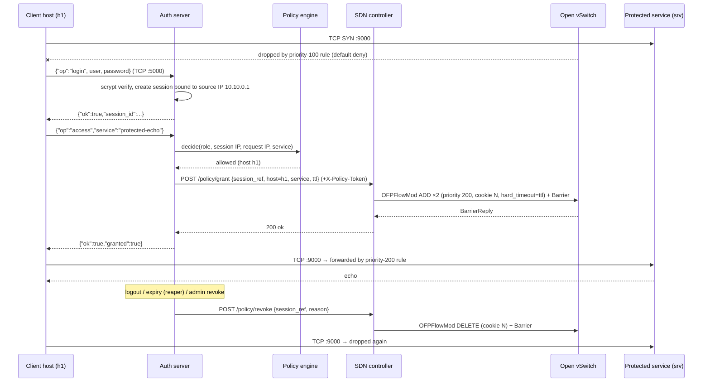

# Architecture (D1)

## Components

```
                    Ubuntu VM
 ┌──────────────────────────────────────────────────────────────────────────────┐
 │  root namespace (10.10.0.254)                                                │
 │   Auth server :5000 (TCP)  ── admin API 127.0.0.1:5001 ──┐                   │
 │        │  HTTP + X-Policy-Token                          │                   │
 │        ▼                                                 ▼                   │
 │   SDN controller (OS-Ken)  ◀──── HTTP 127.0.0.1:8080 ──── Dashboard (Flask)  │
 │   OpenFlow 1.3 :6653              events.jsonl  ◀──────── (reads log)        │
 │        │  OpenFlow                                                           │
 │  ┌─────▼──────────────── Mininet ────────────────────────────────────────┐   │
 │  │             s1 (Open vSwitch, fail_mode=secure)                        │   │
 │  │  port1│   port2│   port3│        port4│              port5│            │   │
 │  │      h1       h2       h3          srv:9000          root-eth0 ───────┼───┘
 │  │  10.10.0.1  .2        .3          10.10.0.100        10.10.0.254      │
 │  └────────────────────────────────────────────────────────────────────────┘   │
 └──────────────────────────────────────────────────────────────────────────────┘
```

| Component | Role | Entry point |
|---|---|---|
| Auth server | TCP login, sessions, authorization, asks controller to grant/revoke | `python3 -m auth.server` |
| Policy engine | Pure allow/deny logic | `policy/engine.py` |
| Controller | Default-deny base rules, grant/revoke rules, flow-table polling, trusted HTTP API | `osken-manager controller.sdn_controller` |
| Topology | 1 OVS, h1–h3, srv, root-namespace link | `network/topology.py` |
| Protected service | TCP echo on srv:9000 | `network/protected_service.py` |
| Dashboard | Read-only live view | `python3 -m dashboard.app` |
| Event log | Shared JSON-lines log | `common/events.py` → `logs/events.jsonl` |

The VM itself joins the lab network through a Mininet link (`root-eth0`, 10.10.0.254), so the auth server and controller can run
as normal processes while the clients inside Mininet reach the auth server over a *real* network path.

## Flow table design (priority ladder)

| Priority | Kind | Match | Action |
|---:|---|---|---|
| 200 | `grant` (installed per session) | in_port, eth_src, eth_dst, IPv4 src/dst, TCP, tcp_dst=9000 (and the reverse path with tcp_src=9000) | output to the right port, **hard timeout** = remaining session time |
| 100 | `default-deny` | IPv4 to `srv`; IPv4 from `srv`; all IPv6 | **drop** |
| 10 | `l2-forward`, `l2-flood` | eth_dst = each host MAC; broadcast | output port / flood |
| 0 | `table-miss` | anything else | send to controller (observe only, never forwarded) |

Because 200 > 100 > 10, no forwarding rule can bypass the policy, and a grant overrides the drop only for one host,
one service and the specific port/MAC/IP tuple. Deleting the grant (by its cookie) restores default-deny immediately.

## Sequence: login → authorisation → rules → traffic → revocation



## Identity ↔ host binding

1. The server learns the client's address from the accepted TCP connection (`peer_ip`); a full 3-way handshake means a blind spoofer never receives the reply.
2. `peer_ip` is looked up in the lab inventory (`config.json`): IP → host name, MAC and switch port.
3. A session is stored with that IP. Every later `access` request must come from the **same** IP, else `session_ip_mismatch`.
4. The controller never receives a username as authority: only `session_ref` (a hash fingerprint), the *host name*, the service name and a TTL, authenticated by the shared token.
5. Rules pin port + MAC + IP, so spoofing another host's IP from a different port does not match.

Limitation: this is a controlled lab association, not strong identity (see README §8).

## Failure behaviour (fail-closed)

| Event | Result |
|---|---|
| Controller or switch unreachable on `access` | not granted (`controller_unavailable`) |
| Controller unreachable on logout/expiry | session ends anyway; revocation stays *pending* and is retried every second; flows also die at their hard timeout |
| Switch rejects a flow-mod | barrier + error check → rollback delete → 500 → not granted |
| Switch reconnects | flow table wiped, base rules reinstalled, grants cleared |
| Auth server restarts | all sessions gone; on start it asks the controller to revoke every grant |

## D1 vs D2

D1 (implemented): everything above. D2 (proposals only): `docs/extension_plan.md`.
